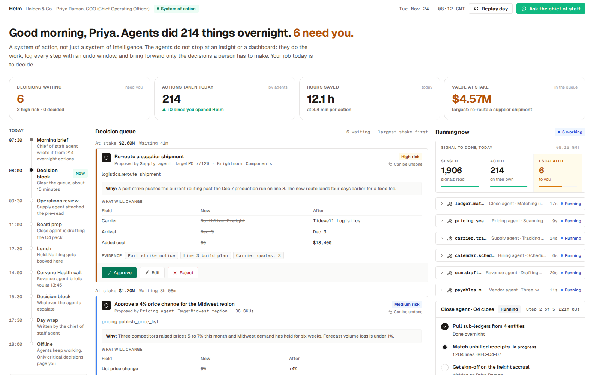
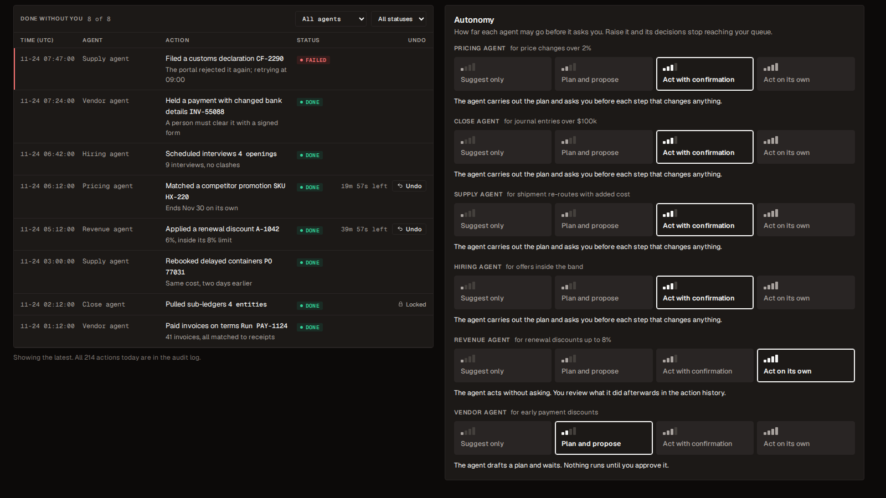

<p align="center"></p>

<h1 align="center">PIX</h1>
<p align="center"><b>Primitives for Intelligent eXperiences</b><br>An open-source design system for AI products — tokens, CSS, React and React Native from one source.</p>

<p align="center">
<a href="https://www.npmjs.com/package/@pix-ui/react"></a>
<a href="LICENSE"></a>
</p>

---

AI interfaces have their own primitives: a response that streams, a trace of what the model did, the sources it cited, a prompt with tools attached, the difference between what the model *claimed* and what is *true*. PIX makes those first-class, next to the usual buttons, tables and forms, and keeps them legible enough to defend in a review.

## Packages

| Package | For | Install |
| --- | --- | --- |
| [`@pix-ui/tokens`](packages/tokens) | Every platform: CSS vars, SCSS, JS/TS, JSON, **iOS** (Swift/SwiftUI), **Android** (XML + Compose), **Flutter**, React Native | `npm i @pix-ui/tokens` |
| [`@pix-ui/css`](packages/css) | Any web framework or plain HTML — `pix-*` classes | `npm i @pix-ui/css` |
| [`@pix-ui/react`](packages/react) | React 18+ / Next.js — 67 components | `npm i @pix-ui/react` |
| [`@pix-ui/react-native`](packages/react-native) | iOS & Android via React Native / Expo | `npm i @pix-ui/react-native` |
| [`@pix-ui/mcp`](packages/mcp) | AI coding tools (Claude Code, Cursor) — an MCP server for the PIX docs | `npx @pix-ui/mcp` |
| [`@pix-ui/a2ui`](packages/a2ui) | Agents that speak A2UI (Agent-to-User Interface) — PIX catalog and React renderer | `npm i @pix-ui/a2ui` |

## Quick start

**React**

```jsx
import "@pix-ui/react/styles.css";
import { AIResponse, PromptInput, Button } from "@pix-ui/react";

export function Assistant() {
  return (
    <>
      <AIResponse
        model="gpt-5" duration="1.4s" tokens="2,140 tokens"
        text="Both runs skipped the certificate read."
        thinking={"Filtered 42 runs\nGrouped by the tool call each omits"}
        citations={[{ label: "run #0042", note: "execution trace" }]}
        onCopy={() => {}} onFeedback={(v) => {}}
      />
      <PromptInput placeholder="Ask a follow-up…" tools={["Replay run"]} />
      <Button variant="filled">Run evaluation</Button>
    </>
  );
}
```

**No build step** — `<script>` tags expose `window.PIX`:

```html
<link rel="stylesheet" href="https://cdn.jsdelivr.net/npm/@pix-ui/react/dist/styles.css">
<script src="https://cdn.jsdelivr.net/npm/react@18/umd/react.production.min.js"></script>
<script src="https://cdn.jsdelivr.net/npm/react-dom@18/umd/react-dom.production.min.js"></script>
<script src="https://cdn.jsdelivr.net/npm/@pix-ui/react/dist/pix.global.js"></script>
<script>
  const { Button } = window.PIX;
  ReactDOM.createRoot(document.getElementById("app")).render(React.createElement(Button, null, "Hello"));
</script>
```

**Vue, Svelte, Angular, HTML** — `import "@pix-ui/css"` and use `<button class="pix-btn pix-btn--filled">`.

**React Native** — wrap in `<PixProvider>` and use `@pix-ui/react-native`.

**SwiftUI / Compose / Flutter** — copy `node_modules/@pix-ui/tokens/dist/{ios,compose,flutter}` into your app: `Color.Pix.accent`, `PixLightColors.accent`, `PixColors.light.accent`.

Dark mode everywhere: `data-theme="dark"` (web), device setting (native).

## Components

| Group | React | React Native |
| --- | --- | --- |
| **AI** | `AIResponse` `Conversation` `Markdown` `ToolCall` `ApprovalCard` `ThinkingTrace` `PromptInput` `PlanView` `InlineCitation` `SourcePanel` `ConfidenceBadge` `AutonomySetting` `InferenceChain` `ExecutionTrace` `FingerprintDiff` `InvariantPanel` `CodeEditor` `InlineCode` | `AIResponse` `ThinkingTrace` `PromptInput` `ConfidenceBadge` |
| **Data** | `DataTable` `MetricCard` `BarChart` `RateBars` `CoverageMatrix` `StageFlow` `TaxonomyTree` `AuditLog` `ActionHistory` `UsageMeter` | `MetricCard` |
| **Inputs** | `Button` `TextField` `Textarea` `Checkbox` `Select` `MultiSelect` `RadioGroup` `Switch` `SearchField` `SavedSearch` `FormActions` `ProviderConfig` | `Button` `Switch` `TextField` |
| **Feedback** | `Alert` `AlertAction` `Callout` `Badge` `Toast` `ToastProvider` `Tooltip` `EmptyState` `Skeleton` `LicenseBanner` | `Callout` `Badge` `Skeleton` |
| **Layout & navigation** | `Page` `Stack` `Grid` `Split` `Card` `Dialog` `Popover` `Tabs` `Menu` `Sidebar` `Stepper` `Disclosure` `NextSteps` `GettingStarted` `PlanCard` `Avatar` `AvatarGroup` | `Stack` `Card` `Avatar` `Text` |

Every React component accepts `loading` to render a skeleton in its own footprint.

## Design principles

1. **Legible over impressive.** Verdicts in words, identifiers in monospace, no chart that exists only to look analytical.
2. **Show the work.** Reasoning, tool calls and sources sit one click from every answer.
3. **Claim ≠ truth.** What a model said (`--claim`, red) and the verified answer (`--truth`, emerald) never share a colour; authored faults are amber (`--fault`).
4. **Calm chrome.** Warm stone neutrals, one emerald accent used sparingly, sentence case, no emoji.
5. **Accessible by default.** 4.5:1 text contrast in both themes, keyboard reachable, reduced-motion respected.

## Examples

`examples/html-starter` (plain HTML), `examples/ai-patterns` (assistant page, sidebar panel, inline entry points) and `examples/pact-console` — a full agent-evaluation console built on PIX, where the system started.

Minimal per-framework starters, each installing PIX from npm:

| Starter | Framework | Package |
| --- | --- | --- |
| [`examples/nextjs`](examples/nextjs) | Next.js (App Router) | `@pix-ui/react` |
| [`examples/vite-react`](examples/vite-react) | Vite + React | `@pix-ui/react` |
| [`examples/angular`](examples/angular) | Angular (standalone components) | `@pix-ui/css` |

## Layouts

Full screens built only from PIX components, ready to copy as a starting point. Preview each one at any width and read its source on the **[Blocks](https://pixui.digitalwithdeep.com/blocks/)** page; the source lives in [`apps/docs/app/(home)/blocks`](apps/docs/app/(home)/blocks).

<a href="https://pixui.digitalwithdeep.com/blocks/helm/">
<picture>
  <source media="(prefers-color-scheme: dark)" srcset="assets/marketing/helm-hero-dark.png">
  
</picture>
</a>

**Helm** shows what a system of action looks like: agents do the work overnight, and the executive only makes the decisions they bring forward. Every agent action is logged with an undo window, and each agent's autonomy is set per decision type.



| Layout | What it is | Built with |
| --- | --- | --- |
| [Helm](https://pixui.digitalwithdeep.com/blocks/helm/) | Executive command center (a system of action) | `ApprovalCard` `ToolCall` `PlanView` `ActionHistory` `AutonomySetting` `Conversation` |
| [Copilot](https://pixui.digitalwithdeep.com/blocks/copilot/) | Agent chat app | `Conversation` `ToolCall` `ApprovalCard` `PlanView` `Markdown` `PromptInput` |
| [Approvals](https://pixui.digitalwithdeep.com/blocks/approvals/) | Agent approvals desk | `ApprovalCard` `ActionHistory` `AutonomySetting` `Dialog` `ToastProvider` |
| [Research](https://pixui.digitalwithdeep.com/blocks/research/) | Cited research assistant | `InlineCitation` `SourcePanel` `ConfidenceBadge` `Tooltip` `Markdown` |
| [Workspace](https://pixui.digitalwithdeep.com/blocks/workspace/) | Agent settings | `Card` `TextField` `Textarea` `Checkbox` `AutonomySetting` `Popover` `Dialog` |
| [Relay](https://pixui.digitalwithdeep.com/blocks/relay/) | Human-in-the-loop inbox | `AIResponse` `ExecutionTrace` `InvariantPanel` `AuditLog` `MetricCard` |
| [Lumen](https://pixui.digitalwithdeep.com/blocks/lumen/) | AI chat assistant | `AIResponse` `ThinkingTrace` `PromptInput` `Menu` |

More on the Blocks page: Proofbench, Sentinel, Lens, Atlas, Forge, Beacon, Guardrail and Lynx. To copy one into a React app, take its `page.tsx`, swap the docs-only `ThemedShell` wrapper for a fragment, and import `@pix-ui/react/styles.css` once at the root. Helm, Copilot, Approvals, Research, Workspace and Relay style their layout inline; some of the others also use Tailwind utility classes.

## AI coding tools

PIX is installable from AI coding tools such as Claude Code and Cursor:

- **shadcn registry** — `npx shadcn add https://pixui.digitalwithdeep.com/r/button-variants.json` installs `@pix-ui/react` and drops a working example into your project. Every docs example is an item.
- **MCP (Model Context Protocol) server** — [`@pix-ui/mcp`](packages/mcp) lets your agent list components, read props and examples, and get suggestions: `claude mcp add pix -- npx -y @pix-ui/mcp`.
- **llms.txt** — the docs as plain text at [`/llms.txt`](https://pixui.digitalwithdeep.com/llms.txt) and [`/llms-full.txt`](https://pixui.digitalwithdeep.com/llms-full.txt).

See [Use PIX with AI coding tools](https://pixui.digitalwithdeep.com/docs/ai-tools/) for setup in each tool.

## Use with Claude

- **Claude Code** — add the PIX MCP server so Claude looks up real props instead of guessing: `claude mcp add pix -- npx -y @pix-ui/mcp` (or `--scope project` to share it through `.mcp.json`).
- **Any Claude chat** — paste [`/llms.txt`](https://pixui.digitalwithdeep.com/llms.txt), [`/llms-full.txt`](https://pixui.digitalwithdeep.com/llms-full.txt) or one component's Markdown page as context.
- **Your repo** — a ready-made `CLAUDE.md` section that tells Claude to build UI with PIX components and tokens, plus starter prompts.

See [Use PIX with Claude](https://pixui.digitalwithdeep.com/docs/use-with-claude/) for all of it.

## Documentation

**[pixui.digitalwithdeep.com](https://pixui.digitalwithdeep.com)** — component reference, per-framework guides, and live previews. Built from [`apps/docs`](apps/docs) with Fumadocs and deployed to Firebase Hosting on every push to `main` (see [`docs/DEPLOY-DOCS.md`](docs/DEPLOY-DOCS.md)).

## Contributing

See [CONTRIBUTING.md](CONTRIBUTING.md). Released under the [MIT License](LICENSE).
